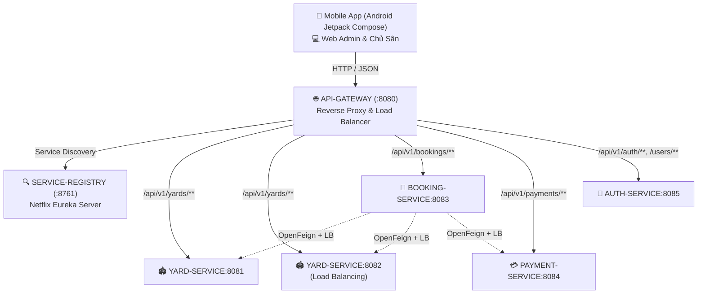

# HƯỚNG DẪN CÀI ĐẶT & VẬN HÀNH HỆ THỐNG MICROSERVICES ANTA
> **Kiến trúc Microservices hoàn chỉnh: API Gateway + Netflix Eureka Discovery + Load Balancing + Inter-service Orchestration**

---

## 🏗️ 1. Bản đồ Kiến trúc Microservices Hệ thống



---

## 🚀 2. Khởi động nhanh (Quickstart)

### Cách 1: Khởi động 1-Click trên Windows (Khuyên dùng)
Nhấp đúp chuột vào file:
👉 **`start-all-services.bat`**

Hệ thống sẽ tự động khởi chạy lần lượt 7 tiến trình Microservices:
1. `service-registry` (Eureka Server - Cổng 8761)
2. `yard-service` Instance 1 (Cổng 8081)
3. `yard-service` Instance 2 (Cổng 8082 - phục vụ Cân bằng tải)
4. `booking-service` (Consumer điều phối - Cổng 8083)
5. `payment-service` (Thanh toán Sandbox - Cổng 8084)
6. `auth-service` (Xác thực & Tài khoản - Cổng 8085)
7. `api-gateway` (Cổng trung tâm điều hướng - Cổng 8080)

*(Khi muốn tắt toàn bộ, chỉ cần nhấp đúp vào file **`stop-all-services.bat`**)*.

---

### Cách 2: Khởi động toàn bộ bằng Docker Compose
```bash
# 1. Chuyển vào thư mục dự án
cd d:\hdv

# 2. Khởi động toàn bộ cụm container
docker compose up -d

# 3. Kiểm tra danh bạ Eureka
start http://localhost:8761
```

---

## 🌐 3. Bảng tra cứu Endpoint qua API Gateway (Cổng 8080)

Tất cả các Client (Android App, Web) chỉ cần giao tiếp qua **cổng duy nhất `8080` (API Gateway)**:

| Nghiệp vụ | Endpoint qua Gateway (:8080) | Dịch vụ xử lý ngầm |
|:---|:---|:---|
| **Thông tin Gateway & Tuyến đường** | `GET /api/v1/gateway/info` | `API-GATEWAY` |
| **Đăng nhập hệ thống** | `POST /api/v1/public/auth/login` | `AUTH-SERVICE:8085` |
| **Thông tin tài khoản** | `GET /api/v1/users/me` | `AUTH-SERVICE:8085` |
| **Danh mục sân & Môn thể thao** | `GET /api/v1/yards` | `YARD-SERVICE:8081 / 8082` |
| **Kiểm tra sân trống** | `GET /api/v1/yards/yard-01/availability` | `YARD-SERVICE:8081 / 8082` |
| **Tạo đơn đặt sân** | `POST /api/v1/bookings` | `BOOKING-SERVICE:8083`<br>*(Tự động gọi Yard + Payment)* |
| **Khởi tạo thanh toán** | `POST /api/v1/payments/intents` | `PAYMENT-SERVICE:8084` |
| **Eureka Server Dashboard** | `http://localhost:8761` | `SERVICE-REGISTRY:8761` |

---

---

## 📁 4. Cấu trúc thư mục dự án (Frontend & Backend)

Hệ thống được tổ chức chuẩn hóa và phân định rõ ràng thành 2 phân hệ chính:

```
hdv/
├── frontend/                    # 🌐 TOÀN BỘ GIAO DIỆN WEB
│   ├── index.html               # Trang điều hướng tập trung vào các cổng Web Anta
│   ├── README.md                # Hướng dẫn chi tiết phân hệ Web
│   ├── admin/                   # 👑 Cổng Quản Trị Hệ Thống (Anta Admin Portal)
│   │   ├── index.html           # Bảng điều khiển Quản trị viên
│   │   ├── app.js               # Logic gọi API Quản trị
│   │   └── style.css            # Style giao diện
│   └── owner/                   # 🏟️ Cổng Dành Cho Chủ Sân (Anta Owner Portal)
│       ├── index.html           # Giao diện vận hành lịch sân & check-in
│       ├── app.js               # Logic gọi API Kênh chủ sân
│       └── style.css            # Style giao diện
│
├── backend/                     # ⚙️ TOÀN BỘ MÃ NGUỒN MÁY CHỦ & ỨNG DỤNG DI ĐỘNG
│   ├── app/                     # 📱 Ứng dụng di động Android (Jetpack Compose, Kotlin)
│   ├── api-gateway/             # 🌐 Cổng đón tiếp API Gateway (:8080)
│   ├── service-registry/        # 🔍 Danh bạ dịch vụ Netflix Eureka Server (:8761)
│   ├── auth-service/            # 🔑 Dịch vụ xác thực & tài khoản (:8085)
│   ├── yard-service/            # 🏟️ Dịch vụ quản lý sân & kiểm tra lịch trống (:8081, :8082)
│   ├── booking-service/         # 📅 Dịch vụ đặt sân & điều phối liên dịch vụ (:8083)
│   ├── payment-service/         # 💳 Dịch vụ thanh toán Sandbox (:8084)
│   ├── docker-compose.yml       # Cấu hình khởi chạy cụm Microservices
│   ├── start-all-services.bat   # Script khởi chạy nhanh Microservices
│   └── stop-all-services.bat    # Script dừng Microservices
│
├── docs/                        # 📚 Tài liệu thiết kế kiến trúc Microservices & API
├── docker-compose.yml           # Khởi chạy Docker từ thư mục gốc
├── start-all-services.bat       # Script 1-click khởi chạy toàn bộ dịch vụ từ gốc
├── stop-all-services.bat        # Script tắt dịch vụ
└── HD_CAIDAT.md                 # Hướng dẫn chi tiết này
```

---

## 📱 5. Kết nối Android App & Web Admin

* **Android App (`backend/app/`)**:
  * Mở thư mục dự án trong Android Studio và chạy Run.
  * Ứng dụng đã có sẵn nút chuyển đổi nhanh sang Web cho **Chủ sân & Admin** tại màn hình Đăng nhập.
* **Web Admin & Chủ sân (`frontend/`)**:
  * Mở [frontend/index.html](file:///d:/hdv/frontend/index.html) để truy cập trung tâm điều hướng Web Anta.
  * Mở [frontend/admin/index.html](file:///d:/hdv/frontend/admin/index.html) để truy cập Cổng Quản Trị Hệ Thống Anta.
  * Mở [frontend/owner/index.html](file:///d:/hdv/frontend/owner/index.html) để truy cập Cổng Chủ Sân Anta.
