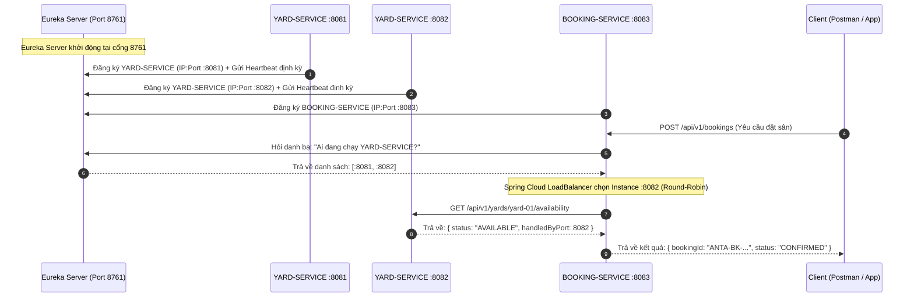

# THIẾT KẾ VÀ HOẠT ĐỘNG CỦA SERVICE REGISTRY (EUREKA)

### 1. Kiến trúc Service Registry
- **Công nghệ**: Spring Boot 4.1.2 / Spring Cloud 2025.1.4 với Netflix Eureka Server.
- **Cổng dịch vụ**: `8761`.
- **Dashboard**: `http://localhost:8761`.

### 2. Luồng đăng ký và khám phá dịch vụ (Service Discovery Flow)

### 3. Cơ chế chịu lỗi (Fault Tolerance)
- Khi một instance của `YARD-SERVICE` bị tắt (ví dụ cổng 8081 gặp sự cố), các request tiếp theo tự động được định tuyến sang cổng 8082 còn lại mà không gây gián đoạn cho khách hàng.
- Eureka duy trì trạng thái các instance thông qua nhịp đập heartbeat (chu kỳ 30 giây). Nếu quá thời hạn không nhận được heartbeat, instance sẽ bị tự động loại bỏ (eviction).
